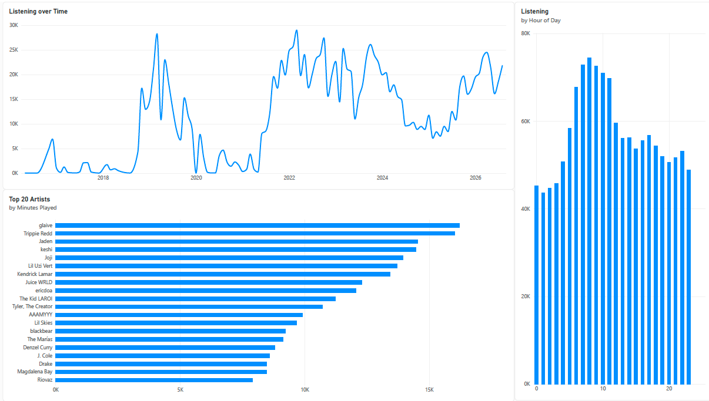

# Spotify Listening History Dashboard

Interactive dashboards analyzing ~10 years of my Spotify streaming
history (1.3M+ minutes played), built from raw JSON exports cleaned and
prepared in R, and visualized in both Tableau and Power BI.

## Live Dashboard:
[View it on Tableau Public](https://public.tableau.com/views/SpotifyListeningHistoryDashboard_17918362274180/SpotifyListeningHistory?:language=en-US&publish=yes&:sid=&:redirect=auth&:display_count=n&:origin=viz_share_link)

## Power BI Version:
The same data rebuilt in Microsoft Power BI - listening trends over time,
top 20 artists and listening by hour of day.

## Tools:
- **R** (`jsonlite`, `dplyr`, `lubridate`) - merging and cleaning raw data
- **Tableau Public** - visualization and dashboard
- **Microsoft Power BI** - dashboard rebuild

## What is included:
**Tableau:**
- Listening trends from 10+ years (2016-2026)
- Top 20 / Top 50 Artists by total playtime (in minutes)
- Listening Patterns shown by Hour of Day.
- A weekday x hour heat map of listening activity.

**Power BI:**
- Listening Over Time, Top 20 Artists, and Listening by Hour of Day

## Process:
1. Exported extended listening history from Spotify (downloadable from personal data) (folder with multiple JSON files).
2. Merged all data into a CSV file in R, created time fields (months, days, minutes and hours), dropped missing fields and personal information.
3. Loaded the cleaned CSV into Tableau and Power Bi and built different ways to visualize the data.

## Files:
- `SpotifyListeningHistoryDataCleaning.R` - data merging and cleaning script
- `dashboard.png` — Tableau dashboard screenshot
- `Spotify Listening History_PowerBI.pdf` - Power BI dashboard export
- `PowerBI_Dashboard.png` - Power BI dashboard screenshot
