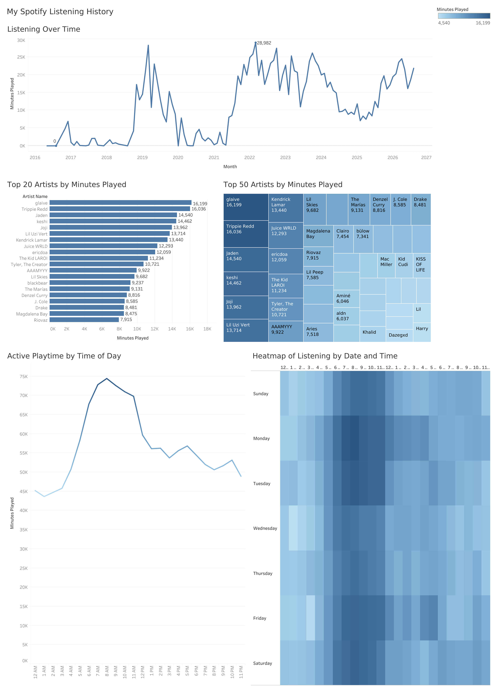

# Spotify Listening History Dashboard

An interactive Tableau dashboard analyzing ~10 years of my Spotify
streaming history (1.3M+ minutes played), built from raw JSON exports
cleaned and prepared in R.

## Live Dashboard:
[View it on Tableau Public](https://public.tableau.com/views/SpotifyListeningHistoryDashboard_17918362274180/SpotifyListeningHistory?:language=en-US&publish=yes&:sid=&:redirect=auth&:display_count=n&:origin=viz_share_link)

## Tools:
- **R** (`jsonlite`, `dplyr`, `lubridate`) — merging and cleaning raw data
- **Tableau Public** — visualization and dashboard

## What is included:
- Listening trends from 10+ years (2016-2026)
- Top 20 / Top 50 Artists by total playtime (in minutes)
- Listening Patterns shown by Hour of Day.
- A weekday x hour heat map of listening activity.

## Process:
1. Exported extended listening history from Spotify (downloadable from personal data) (folder with multiple JSON files).
2. Merged all data into a CSV file in R, created time fields with existing data, dropped missing fields and personal information.
3. Loaded the cleaned CSV into Tableau and built five ways to interpret the data.

## Files:
- `SpotifyListeningHistoryDataCleaning.R` - Data merging and cleaning script
